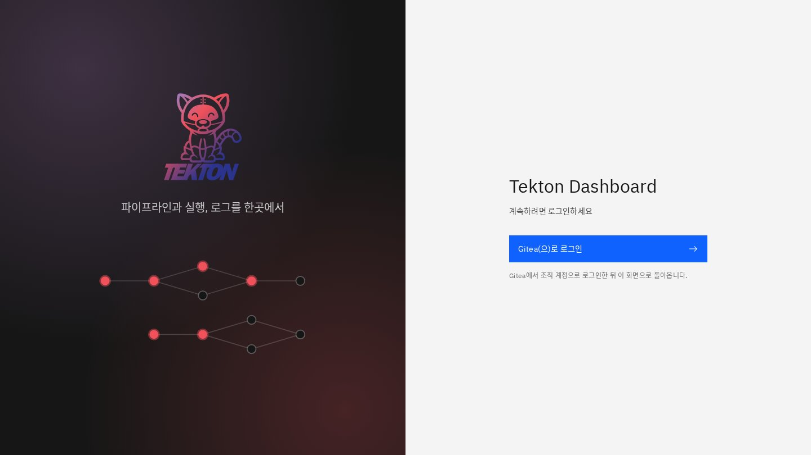

# Tekton Dashboard (Customized Version)

Tekton Dashboard는 [Tekton Pipelines](https://github.com/tektoncd/pipeline)와
[Tekton Triggers](https://github.com/tektoncd/triggers) 리소스를 관리하기 위한 범용 웹 기반 UI입니다.

**이 저장소는 공식 Tekton Dashboard를 기반으로, 운영 효율성과 사용자 편의를 위해 주요 기능을 커스터마이징한 버전입니다.**

| 항목 | 값 |
|---|---|
| Upstream 기준 | [tektoncd/dashboard `v0.72.0`](https://github.com/tektoncd/dashboard/releases/tag/v0.72.0) |
| 배포 버전 | `v0.72.0-custom-oidc` |
| 이미지 | `harbor.114-110-181-178.nip.io/nnd/tekton-custom-dashboard:v0.72.0-custom-oidc` |
| 운영 주소 | https://tekton.<cluster-domain> (Gitea OIDC 로그인) |

### 버전

| git 태그 | 이미지 태그 | 내용 |
|---|---|---|
| `v0.72.0-custom-oidc` | `v0.72.0-custom-oidc` | 아래 1~6 전체. Gitea OIDC 로그인 + 사용자별 k8s 권한(impersonation) — **현재 운영** |
| `v0.72.0-custom` | `v0.72.0-custom` | 아래 1~5. 로그인 없음(앞단 인증은 oauth2-proxy 등 별도 구성) |
| `v0.61-custom-backup` | – | v0.61 기반 이전 커스텀 백업 |

특정 버전의 코드는 `git checkout <git 태그>`로 받을 수 있습니다. 로그인 기능은 `v0.72.0-custom-oidc` 이미지에서도 `--oidc-issuer`를 비우면 끌 수 있습니다(6번 참고).

---

## 주요 변경 사항 (Custom Features)

### 1. 파이프라인 재시작 로직 개선 (Smart Restart)

* **기존:** 'Start'는 Pending 상태의 PipelineRun을 실행 대기 해제하는 용도로만 동작.
* **변경:** 'Start' 클릭 시 기존 설정을 기반으로 **새로운 PipelineRun 리소스를 생성**하여 실행합니다.
  실행 이력을 보존하고 충돌 없이 즉시 재작업할 수 있습니다.
* 목록 / 상세 화면 모두 동일하게 동작하며, 액션 메뉴 순서도 **재실행 → 시작 → 편집 및 실행** 으로 통일했습니다.
* 상세 화면에서 실행하면 생성된 새 PipelineRun 링크가 알림으로 표시됩니다.

> TaskRun의 'Start'는 upstream 동작(Pending 해제)을 그대로 유지합니다.

### 2. 검색 기능 직관화 (Basic Search)

* **기존:** Label 기반의 Key-Value 검색만 가능.
* **변경:** 검색창에 **일반 텍스트(키워드)** 를 입력하면 이름·네임스페이스로 즉시 필터링됩니다.
  `labelKey:labelValue` 형식으로 입력하면 기존처럼 라벨 필터가 적용되므로 두 방식을 함께 쓸 수 있습니다.
* 검색 규칙
  * 대소문자 무시
  * 공백으로 나눈 여러 토큰은 **AND** 조건 (`fastapi deploy`)
  * 이름을 `-` `_` `.` `/` 로 분해해 매칭 (`build` → `sample_prod.build/pr`)
  * 구분자를 제거한 형태도 매칭 (`fastapibetest` → `fastapi-be-test-...`)
* 입력 후 400ms 디바운스로 적용되며, 입력을 지우면 즉시 해제됩니다.

### 3. 파이프라인 종합 현황판 (Pipeline Status View)

* About 페이지 상단에 전체 파이프라인 실행 상태를 한눈에 보는 **도넛 차트 현황판**을 추가했습니다.
* 네임스페이스(`*-cicd`) 별로 총 / 실행 중 / 최근 12시간 실행 건수를 집계하며, 수동 새로고침을 지원합니다.

### 4. 목록 페이지 사이즈 확대

* 기본 페이지 사이즈 100 → **1000**, 선택 값 `[50, 100, 500, 1000]`.

### 5. 배포 관련

* 멀티스테이지 `Dockerfile` (UI 빌드 → Go 빌드 → distroless 런타임).
* 개발 서버용 `/results-api` 프록시 설정 (`vite.config.js`).

### 6. OIDC 로그인 (ArgoCD 방식)



* `--oidc-issuer`를 설정하면 대시보드 자체 로그인 화면이 생깁니다. ArgoCD처럼 좌우 분할 화면에 **Gitea(으)로 로그인** 버튼이 있고, 다크 모드와 모바일 화면에 맞춰 바뀝니다.
* 헤더에 로그인한 사용자 이름과 로그아웃 버튼이 표시됩니다.
* 로그인한 사용자의 k8s API 요청은 **Impersonation**으로 처리합니다. 사용자는 `<username>`, 그룹은 `gitea:<group>`으로 요청합니다.
  이 매핑은 NKS apiserver의 Gitea OIDC 매핑(kubectl 로그인 시 적용되는 규칙)과 같습니다. 따라서 기존 RoleBinding을 그대로 씁니다.
  권한은 클러스터 RoleBinding이 결정합니다. 대시보드 SA 권한이 사용자에게 그대로 넘어가지 않습니다.
* 세션은 암호화 쿠키(24h)에 저장되고, 그룹은 ID 토큰의 `groups` 클레임에서 가져옵니다. 클레임이 없으면 userinfo에서 가져옵니다.
* `--oidc-issuer`가 비어 있으면 기존 동작 그대로입니다(로그인 없음).
* 설계와 구현 계획: `docs/superpowers/specs/2026-11-18-oidc-login-design.md`, `docs/superpowers/plans/2026-11-18-oidc-login.md`

**현재 운영 구성** (`tekton-pipelines` 네임스페이스)

| 항목 | 값 |
|---|---|
| Gitea OAuth 앱 | client_id `b6d505e4-…` (ArgoCD·NKS apiserver와 같은 앱) |
| Redirect URL | `https://tekton.<cluster-domain>/oauth2/callback` (oauth2-proxy 시절 등록값 재사용) |
| Secret | `tekton-dashboard-oidc` (`OIDC_CLIENT_SECRET`, `SESSION_KEY`) |
| Gitea CA | ConfigMap `tekton-dashboard-oidc-ca` → `--oidc-ca-file=/etc/oidc-ca/ca.crt` (NND Internal CA, TLS 검증 유지) |
| impersonate 권한 | ClusterRoleBinding `tekton-dashboard-impersonator` → SA `tekton-dashboard` |
| 라우트 | HTTPRoute `tekton-route`, `oauth2-route` → `tekton-dashboard:9097` |

| Gitea 소속 | 적용되는 k8s 권한 |
|---|---|
| `oauth_organization` admins 팀 | `tekton-editor-global` (Tekton 리소스 실행·수정·삭제) |
| `oauth_organization` viewers 팀 | `tekton-reviewer-global` (조회 전용) |
| `oauth_organization` 조직원 | `tekton-dashboard-tenant` (네임스페이스 목록 등 기본 조회) |
| 소속 없음 | 로그인은 되지만 아무것도 보이지 않음 |

롤백할 때는 **순서가 중요합니다.** 이전 이미지는 클라이언트가 보낸 `Impersonate-*` 헤더를 걸러내지 못하므로 impersonate 권한부터 회수해야 합니다.

```sh
kubectl delete clusterrolebinding tekton-dashboard-impersonator   # 반드시 먼저
kubectl -n tekton-pipelines rollout undo deploy/tekton-dashboard
# 이후 앞단 인증(oauth2-proxy 등)을 다시 연결

<details>
<summary>설정 방법</summary>

1. Gitea → Site Administration → Integrations → OAuth2 Applications에서 앱을 등록합니다.
   Redirect URI는 `https://<dashboard-host>/auth/callback`입니다. 이미 등록된 URI(예: oauth2-proxy의 `/oauth2/callback`)를 그대로 써도 됩니다.
   Gitea는 로그인한 뒤에야 redirect URI를 검사하므로, 등록이 빠지면 로그인 직후 `Unregistered Redirect URI` 오류가 납니다.
2. Secret을 생성합니다.

   ```sh
   kubectl -n tekton-pipelines create secret generic tekton-dashboard-oidc \
     --from-literal=OIDC_CLIENT_SECRET=<client-secret> \
     --from-literal=SESSION_KEY="$(openssl rand -base64 32)"
   ```
3. impersonate 권한을 부여하고 Deployment에 설정을 추가합니다.

   ```sh
   kubectl apply -f config/oidc-impersonator.yaml
   kubectl -n tekton-pipelines set env deploy/tekton-dashboard --from=secret/tekton-dashboard-oidc
   kubectl -n tekton-pipelines patch deploy tekton-dashboard --type=json -p '[
     {"op":"add","path":"/spec/template/spec/containers/0/args/-","value":"--oidc-issuer=https://gitea.example.com"},
     {"op":"add","path":"/spec/template/spec/containers/0/args/-","value":"--oidc-client-id=<client-id>"},
     {"op":"add","path":"/spec/template/spec/containers/0/args/-","value":"--oidc-redirect-url=https://<dashboard-host>/auth/callback"}
   ]'
   ```

   YAML 매니페스트로 쓸 때는 `"--oidc-groups-prefix=gitea:"`처럼 따옴표로 감싸야 합니다. 끝의 `:` 때문에 YAML이 매핑으로 해석합니다.
   자체 서명 인증서라면 CA를 ConfigMap으로 마운트하고 `--oidc-ca-file`을 지정합니다(`--oidc-insecure-skip-verify`보다 권장).
4. 그룹에 권한을 겁니다(Gitea 그룹 형식은 `<org>` / `<org>:<team>`).

   ```sh
   # tekton_pipeline_manager(01-5.init-tekton-group-role)가 만드는 바인딩이 이미 있으면 생략
   #   tekton-editor-global   -> gitea:oauth_organization:admins
   #   tekton-reviewer-global -> gitea:oauth_organization:viewers
   # 사전 확인
   kubectl auth can-i create pipelineruns -n fastapi-cicd \
     --as=alice --as-group=gitea:oauth_organization:viewers
   ```

| 플래그 | 기본값 | 설명 |
|---|---|---|
| `--oidc-issuer` | | 설정 시 로그인 활성화 |
| `--oidc-client-id` / `--oidc-redirect-url` | | 필수. 콜백은 redirect URL의 경로에서 처리합니다. oauth2-proxy에서 넘어온다면 `https://<host>/oauth2/callback`를 그대로 써서 Gitea 등록을 재사용할 수 있습니다 |
| `--oidc-name` | `Gitea` | 로그인 버튼 문구 |
| `--oidc-username-prefix` | `""` | apiserver OIDC username prefix와 동일하게 설정. `:`가 들어간 username은 로그인 거부 |
| `--oidc-groups-prefix` | `gitea:` | apiserver OIDC groups prefix와 동일하게 설정. 빈 값 불가(`system:masters` 사칭 방지) |
| `--oidc-username-claim` / `--oidc-groups-claim` | `preferred_username` / `groups` | |
| `--oidc-ca-file` | | 자체 서명 인증서 CA(PEM) |
| `--oidc-insecure-skip-verify` | `false` | 비상용 |

필수 값이 하나라도 빠지면 대시보드가 시작되지 않습니다(fail closed).

**켜기/끄기**는 `--oidc-issuer` 값으로만 전환합니다. 빈 값이면 로그인이 꺼지고, 나머지 `--oidc-*` 인자는 무시됩니다.

```sh
# 끄기 (켜기는 반대로 issuer URL을 다시 넣음)
kubectl -n tekton-pipelines get deploy tekton-dashboard -o json \
  | sed 's|--oidc-issuer=https://gitea.example.com|--oidc-issuer=|' | kubectl apply -f -
```

* 로그인을 끄면 접속하는 누구나 대시보드 SA 권한으로 동작합니다. 앞단에 다른 인증을 두거나 내부망에서만 쓰세요.
* 로그인이 꺼져 있을 때 `Authorization` 헤더 없이 들어온 `Impersonate-*` 헤더는 제거됩니다(대시보드 SA 권한으로 다른 사용자를 사칭하는 것을 방지). 오래 끈 채로 쓸 거라면 impersonate 권한(`config/oidc-impersonator.yaml`)도 회수하는 편이 깔끔합니다.
* 화면에서 켜고 끄는 스위치는 일부러 두지 않았습니다.
* 로그인이 꺼진 상태에서 앞단 프록시가 `Authorization`을 넘기면(upstream의 oauth2-proxy·impersonation 프록시 방식) 헤더를 그대로 전달합니다.

**제약 사항**

* 대시보드는 도메인 루트(`https://<host>/`)에서 서비스해야 합니다. 경로 prefix(`/tekton/`) 배포는 지원하지 않습니다.
* `--external-logs`와 함께 쓸 수 없습니다(시작 시 에러). 외부 로그 프록시는 사용자별 RBAC를 적용할 수 없기 때문입니다.
* `--logout-url`을 지정하면 세션을 지운 뒤 그 주소로 이동합니다(예: IdP 로그아웃 URL). 지정하지 않으면 로그인 화면으로 이동합니다.
* `--oidc-redirect-url`은 https여야 하고(localhost 제외), 경로는 `/auth/` 또는 `/oauth2/` 아래여야 합니다.
* 세션은 24시간이며 서버에서 강제로 만료시킬 수 없습니다. Gitea 팀에서 사용자를 빼도 다시 로그인할 때까지는 이전 권한이 유지됩니다. 전원을 즉시 로그아웃시키려면 Secret의 `SESSION_KEY`를 바꾸고 재시작하세요.

</details>

---

## 개발

`package.json` engines 기준 **Node.js 24.16+ / npm 11.9+**, Go 백엔드는 **Go 1.26+** 가 필요합니다.

```sh
npm install
npm run lint && npm test && npm run build   # 전체 검증
go test ./...                               # 백엔드 (pkg/auth, pkg/router)
npm start                                   # 개발 서버 (기본 8000 포트)
```

### 커스텀 코드 위치

아래 파일이 커스텀의 전부이며 나머지는 upstream 그대로입니다.
upstream 갱신 시 이 파일들만 rebase 하면 됩니다.

| 파일 | 내용 |
|---|---|
| `packages/components/src/components/LabelFilter/LabelFilter.jsx` | 텍스트 검색 입력 / 디바운스 / 검색어 태그 |
| `src/api/utils.js` | `useCollection` 텍스트 필터 (`applyClientTextFilter`) |
| `src/containers/About/About.jsx` | 파이프라인 현황판 |
| `src/containers/PipelineRuns/PipelineRuns.jsx` | 목록 액션 메뉴 (Start = 신규 생성) |
| `src/containers/PipelineRun/PipelineRun.jsx` | 상세 액션 메뉴 (목록과 동일) |
| `src/containers/ListPageLayout/ListPageLayout.jsx` | 페이지 사이즈 |
| `Dockerfile`, `.dockerignore`, `vite.config.js` | 빌드 / 배포 |
| `pkg/auth/` | OIDC 로그인, 세션 쿠키, impersonation |
| `pkg/router/router.go`, `cmd/dashboard/main.go` | 보호 경로 래핑, OIDC 플래그 |
| `src/containers/Login/`, `src/containers/App/App.jsx` | 로그인 페이지와 라우트 |
| `src/api/comms.js`, `src/api/index.js` | 401 → 로그인 이동, `useCurrentUser` |
| `src/containers/HeaderBarContent/HeaderBarContent.jsx`, `src/containers/Header/_Header.scss` | 헤더 사용자 표시 |
| `src/nls/messages_{en,ko}.json` | 로그인 문구 |
| `config/oidc-impersonator.yaml` | impersonate 권한(OIDC 사용 시에만 적용) |
| `docs/superpowers/` | OIDC 로그인 설계·구현 계획 |

각 커스텀 동작에는 회귀 테스트가 붙어 있습니다 (`npm test`).

### 컨테이너 이미지 빌드 및 배포

```sh
docker build -t harbor.114-110-181-178.nip.io/nnd/tekton-custom-dashboard:v0.72.0-custom-oidc .
docker push  harbor.114-110-181-178.nip.io/nnd/tekton-custom-dashboard:v0.72.0-custom-oidc

kubectl -n tekton-pipelines rollout restart deploy/tekton-dashboard
kubectl -n tekton-pipelines rollout status  deploy/tekton-dashboard
```

* 태그를 덮어쓰는 방식이므로 Deployment의 `imagePullPolicy`는 `Always` 로 설정되어 있습니다.
* OIDC 이전 이미지(`v0.72.0-custom`)는 롤백용으로 레지스트리에 남겨 두었습니다.
* 프론트엔드 테스트는 Node 24가 필요합니다. 호스트 Node가 낮으면 `node:24` 컨테이너에서 실행합니다.

  ```sh
  podman run --rm -v "$PWD":/w -w /w docker.io/library/node:24 sh -c 'npm run lint && npx vitest run'
  ```
* 화면에 표시되는 버전은 `dashboard-info` ConfigMap의 `version` 값입니다.

  ```sh
  kubectl -n tekton-pipelines patch cm dashboard-info --type merge -p '{"data":{"version":"v0.72.0-custom"}}'
  ```

---

## 기본 기능 (Original Features)

* `PipelineRun` 및 `TaskRun`의 실시간 상태 및 로그 조회
* 리소스 라벨 필터링
* 리소스 개요 및 YAML 명세 확인
* 전체 클러스터 조회 또는 특정 네임스페이스로 조회 범위 제한
* Git 리포지토리에서 리소스 직접 가져오기 (Import)
* 확장 프로그램(Extensions)을 통한 기능 추가


## 문서 및 가이드

* **설치 방법:** [Installing Tekton Dashboard](./docs/install.md)
* **튜토리얼:** ["Getting started" tutorial](./docs/tutorial.md)
* **확장 기능:** [Extensions](./docs/extensions.md)
* **공식 릴리즈:** [releases](https://github.com/tektoncd/dashboard/blob/main/releases.md)
* **공식 문서:** [Tekton 웹사이트](https://tekton.dev/docs)

> 한국어 메시지(`src/nls/messages_ko.json`)는 upstream 공식 번역본을 사용합니다.
> 이전 커스텀 번역본은 일괄 치환 과정에서 메시지 **키**까지 변경되어 번역이 적용되지 않는 상태였습니다.
